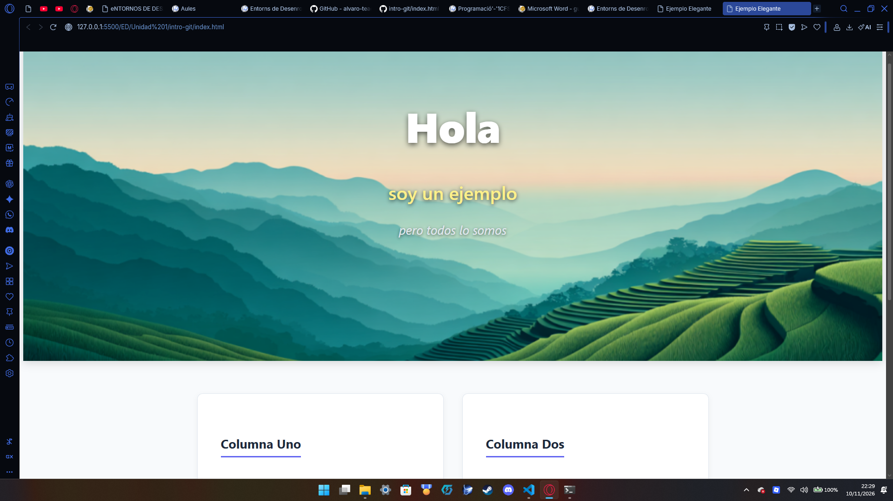
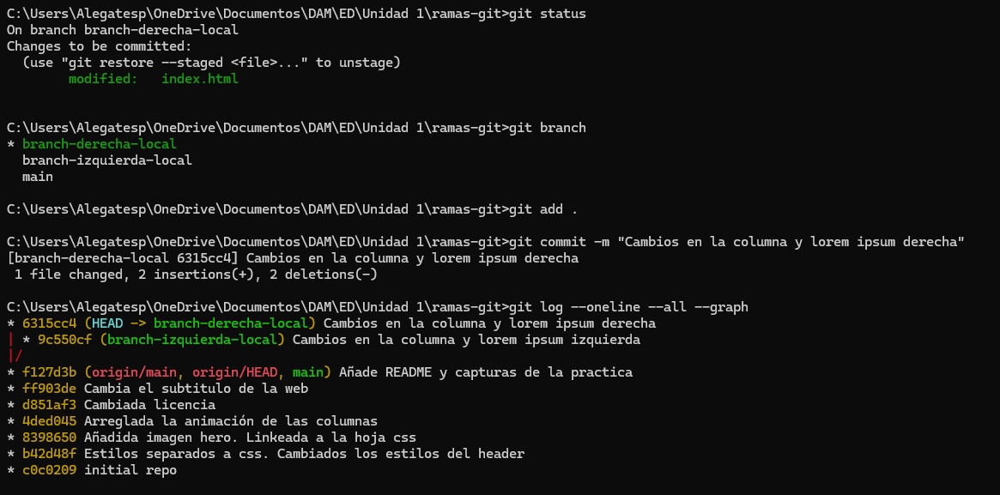
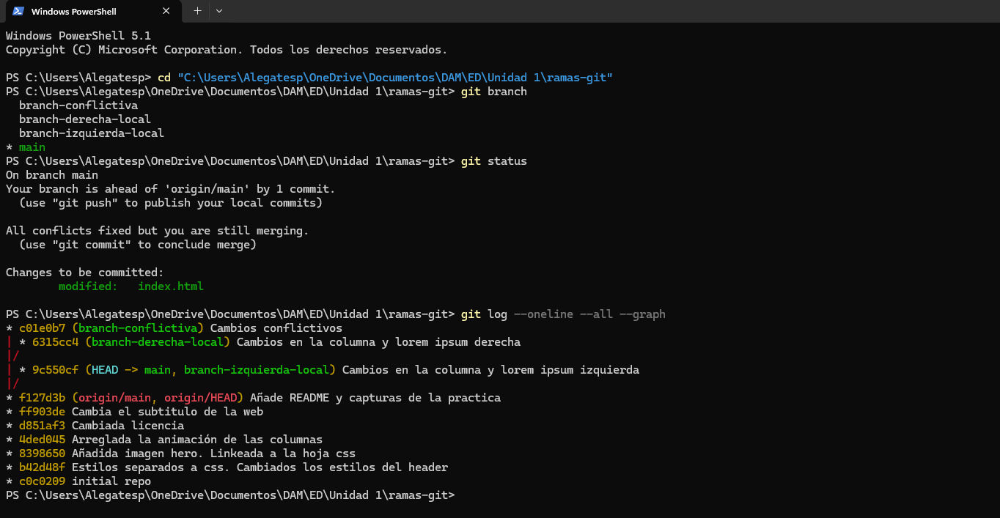
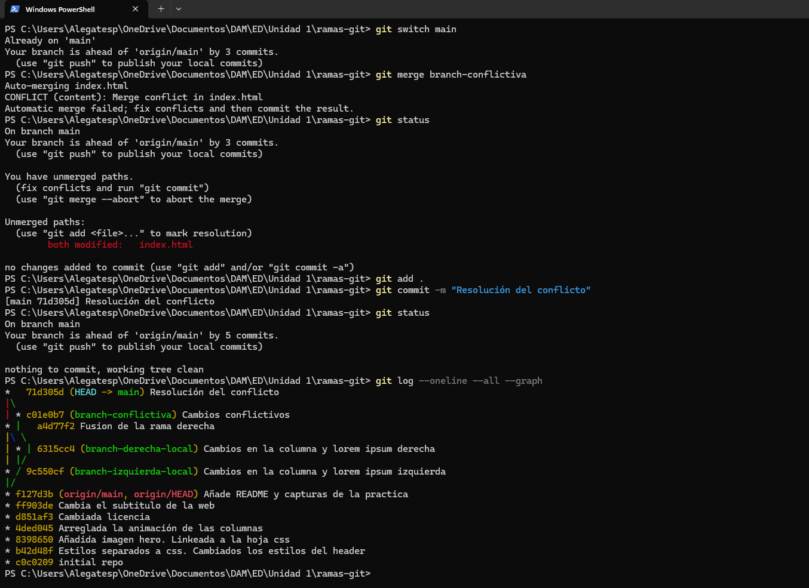

# Proyecto Intro Git

Este proyecto es una sencilla página web utilizada para practicar el uso de Git y GitHub.

Durante la práctica se ha consultado un estado anterior del repositorio, se han comparado los cambios de distintos commits, se ha modificado el subtítulo de la página y se ha publicado el proyecto en un repositorio propio.

## Web en un estado anterior

Estas capturas muestran el aspecto de la página web en un commit anterior:

y(capturas/Estado_Anterior2.png)

## Cambios del commit 4ded045

Estas capturas muestran los cambios realizados en el commit `4ded045`, relacionado con la animación de las columnas:

y(capturas/Codigos_Comandos2.png)

## Trabajo con ramas

### Todas las ramas

Esta captura muestra el estado del repositorio, las ramas disponibles y el historial de todos los commits. Se pueden distinguir las ramas `main`, `branch-derecha-local` y `branch-izquierda-local`, junto con el historial gráfico de sus cambios.

### Creación y detección del conflicto

Esta captura muestra la creación de la rama `branch-conflictiva`, el cambio realizado en `index.html` y el conflicto generado al combinarla con `main`. También se muestran las ramas disponibles y el estado en el que el repositorio queda esperando la resolución del conflicto.

### Resolución del conflicto

Esta captura muestra el final del `merge`, por si me equivoque en la captura de pantalla anterior.